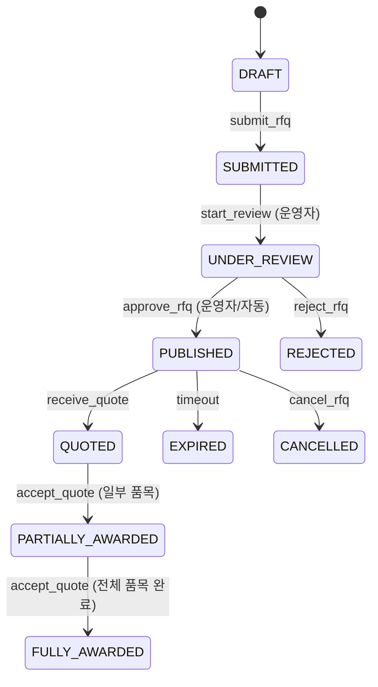

# 도매 거래 핵심 유한상태기계(FSM) 명세서 (STATE_TRANSITIONS_KO)

- **작성 기준일**: 2026-10-18
- **적용 엔진**: Go Core API (`services/api/internal/trade`, `payment`, `logistics`, `settlement`)
- **원칙**: 단일 상태 문자열에 모든 업무 상태를 혼합하지 않고, 주문 업무, 결제, 배송, 분쟁, 정산을 명확히 분리하여 상태 전이를 엄격 통제한다.

---

## 1. 견적 의뢰(RFQ) 수명주기

- **전이 규칙**:
  - `SUBMITTED -> PUBLISHED`: 구매자의 연락처와 비공개 도면/첨부파일을 필터링(익명화)하여 공개 시장에 등록.
  - `accept_quote`: 낙찰 품목의 누적 수량이 요청 수량을 초과할 수 없음.
  - 마감일 경과 시 배치 워커(`services/worker`)에 의해 `EXPIRED`로 전환.

---

## 2. 견적서(Quote & Revision) 수명주기

- **상태 정의**: `DRAFT`, `ISSUED`, `SUPERSEDED`, `ACCEPTED`, `REJECTED`, `EXPIRED`
- **전이 규칙**:
  - `ISSUED -> SUPERSEDED`: 공급사가 단가/납기/조건을 변경할 경우 기존 버전을 수정하지 않고 신규 버전(`quote_revision`)을 발행하며 이전 버전은 `SUPERSEDED`로 동결.
  - `ISSUED -> ACCEPTED`: 구매자가 수락 시 `quote` 및 품목 행 락을 획득하고, 만료 일시, 통화, 공급사 승인 여부를 검증. 주문(`trade_orders`) 1건을 원자적으로 생성. 중복 수락 방지(Idempotency).

---

## 3. 도매 거래 주문(Trade Order) 업무 상태

- **상태 정의**:
  - `DRAFT`: 장바구니/견적 전환 직후
  - `PENDING_APPROVAL`: 구매기업 내부 다단계 결재 대기
  - `APPROVED`: 결재 완료 (또는 결재 비대상)
  - `CONTRACT_PENDING`: 무역 계약서 생성 및 쌍방 서명 대기
  - `CONTRACT_SIGNED`: 계약 체결 완료
  - `PAYMENT_PENDING`: 계약금/선결제 대기
  - `IN_PRODUCTION`: 공급사 생산/포장 진행
  - `INSPECTION_PENDING`: 제3자 또는 구매자 검수 대기
  - `SHIPPED`: 물류 선적/출고 완료 (전량 또는 분할 1차 이상)
  - `CONFIRMED`: 구매자 물품 인수 및 확인
  - `COMPLETED`: 잔금 결제 및 최종 정산 해제 완료
  - `CANCELLED`: 주문 취소 (환불/원장 정리 수반)
  - `DISPUTED`: 분쟁 제기 상태 (정산 자동 동결)

---

## 4. 분할 결제 스케줄(Payment Schedule & Payment)

- **상태 정의**: `PENDING`, `AUTHORIZED`, `PAID`, `FAILED`, `CANCELLED`, `REFUNDED`
- **전이 규칙**:
  - `PENDING -> AUTHORIZED`: PG 카드 가승인 완료 (캡처 대기).
  - `AUTHORIZED / PENDING -> PAID`: 서버-to-PG 승인 검증 성공 시점에 DB 트랜잭션으로 원장 분개와 함께 전환.
  - 가상계좌 발급은 `PENDING` 유지 (입금 웹훅 검증 후 `PAID` 전환).
  - 계약금(Down Payment) `PAID` 시 주문은 `IN_PRODUCTION`으로 전환 허용.
  - 잔금(Balance) `PAID` 및 검수 합격 확인 시 정산 지급 적격 상태(`RELEASE_ELIGIBLE`)로 승격.

---

## 5. 분할 배송(Shipment) 수명주기

- **상태 정의**: `DRAFT`, `PACKED`, `CUSTOMS_CLEARED`, `IN_TRANSIT`, `DELIVERED`, `CANCELLED`
- **전이 규칙**:
  - $\sum \text{shipped\_quantity} \le \text{ordered\_quantity}$ (초과 출고 원천 차단).
  - 운송장 번호(AWB/B/L), 운송사, 패킹리스트 필수 입력.
  - 배송 완료 시 구매자에게 수령 확인 및 검수 요청 통지 발행.

---

## 6. 분쟁 및 중재(Dispute) 수명주기

- **상태 정의**: `OPENED`, `EVIDENCE_SUBMITTED`, `UNDER_MEDIATION`, `RESOLVED_REFUND`, `RESOLVED_REJECTED`, `CLOSED`
- **전이 규칙**:
  - `OPENED`: 분쟁 접수 즉시 해당 주문과 연결된 정산(`settlements`)을 `HELD` 상태로 자동 동결.
  - `RESOLVED_REFUND`: 운영자 중재 완료 후 환불 집행 -> 복식 원장 역분개 -> 남은 잔액에 대해 정산 재계산.
  - `RESOLVED_REJECTED` 또는 `CLOSED`: 동결 해제.

---

## 7. 정산(Settlement & Payout) 수명주기

- **상태 정의**: `HELD`, `RELEASE_ELIGIBLE`, `SCHEDULED`, `PROCESSING`, `PAID_OUT`, `FAILED`
- **지급 조건**:
  - 주문 상태가 `CONFIRMED` 또는 구매 확정 만료일 경과.
  - 검수 조건이 있는 경우 검수 상태 `PASSED`.
  - 진행 중인 분쟁/차지백이 없을 것 (`disputes.status != OPENED`).
  - 공급사 실명 인증 및 정산 계좌 2차 검증 완료.
  - 일일 PG 입금 대사(`reconciliation_runs`) 결과 불일치가 없을 것.
